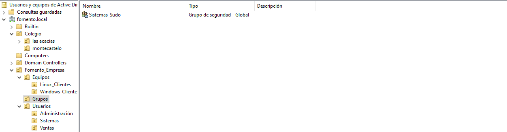
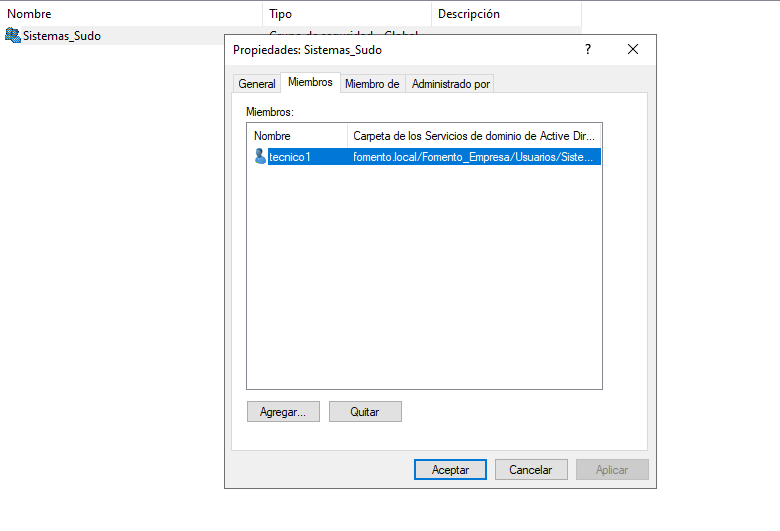
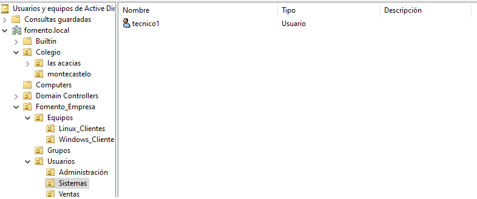
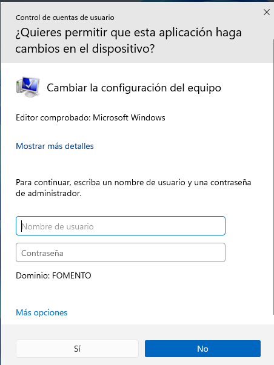
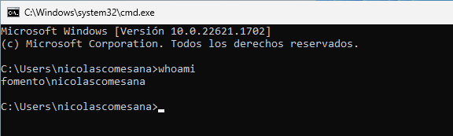
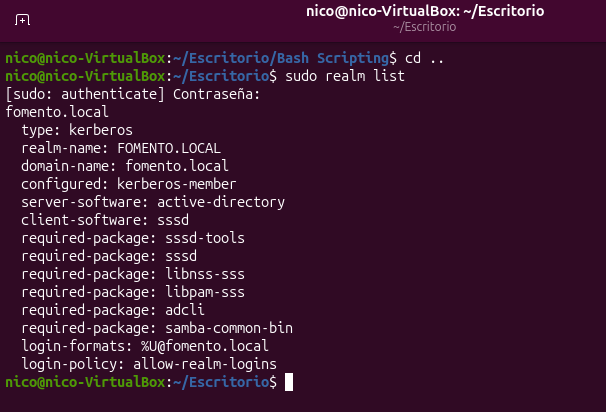

# Integración Híbrida de Clientes (Windows 11 / Ubuntu) en Active Directory y Delegación de Privilegios con SSSD

Este repositorio contiene la documentación detallada y la guía de despliegue para la integración de clientes heterogéneos (**Windows 11** y **Ubuntu Linux**) en un dominio de **Active Directory** (`fomento.local`) administrado desde **Windows Server**.

El objetivo principal es centralizar la gestión de identidades y la delegación de permisos de administración (`sudo`) en entornos Linux mediante grupos de seguridad del Active Directory.

---

## 🛠️ Arquitectura e Infraestructura

* **Controlador de Dominio (PDC):** Windows Server (Dominio: `fomento.local`)
* **Cliente Windows:** Windows 11 Enterprise / Pro
* **Cliente Linux:** Ubuntu Desktop / Server
* **Módulo de Identidad Linux:** SSSD (System Security Services Daemon) + PAM + Realm

---

## 📁 Estructura del Active Directory

La estructura lógica de Unidades Organizativas (OUs) en el Windows Server se ha diseñado dividiendo claramente Equipos, Grupos de seguridad y Usuarios por departamento:



* **Dominio:** `fomento.local`
  * **OU `Fomento_Empresa`**
    * **OU `Equipos`**: `Linux_Clientes`, `Windows_Clientes`
    * **OU `Grupos`**: Contiene el grupo de seguridad global `Sistemas_Sudo`
    * **OU `Usuarios`**: Contiene OUs departamentales (`Administración`, `Sistemas`, `Ventas`)

---

## 👤 Gestión de Identidades en Active Directory

Se ha configurado la delegación de permisos mediante el grupo de seguridad de dominio `Sistemas_Sudo`, al cual se le asignan los técnicos con permisos de administración local.

### 1. Pertenencia al Grupo `Sistemas_Sudo`
El usuario `tecnico1` pertenece al grupo `Sistemas_Sudo` dentro de Active Directory:



### 2. Ubicación del Usuario
El objeto de usuario `tecnico1` se encuentra correctamente alojado dentro de la OU `Sistemas`:



---

## 🖥️ Integración del Cliente Windows 11

El cliente Windows 11 se ha unido al dominio `fomento.local`, permitiendo el inicio de sesión con credenciales de Active Directory.

### 1. Validación de Pertenencia al Dominio
Comprobación mediante el diálogo de elevación de UAC y propiedades del sistema:



### 2. Verificación de Sesión con Usuario de Dominio
Comprobación de identidad ejecutando `whoami` desde la consola del cliente Windows 11:



---

## 🐧 Integración del Cliente Ubuntu (SSSD + Sudoers)

La integración del cliente Linux se realiza mediante SSSD para la autenticación PAM y la resolución de identidades de Active Directory.

### 1. Verificación de Unión al Dominio (`realm list`)
El cliente Linux se encuentra registrado correctamente como miembro Kerberos del dominio:



```bash
sudo realm list
